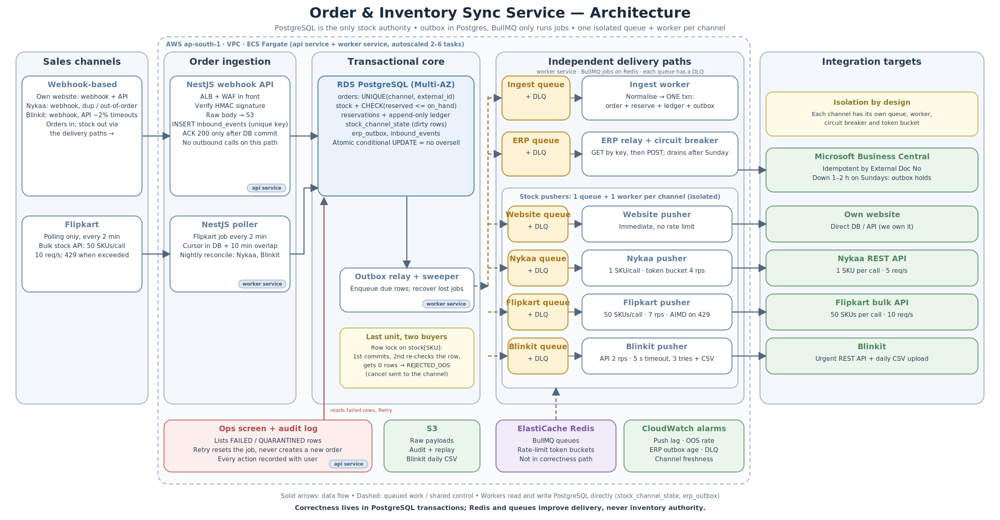

# Order & Inventory Sync Service

A design for keeping **orders and stock in sync across four sales channels** (own website, Nykaa, Flipkart, Blinkit) with **Microsoft Business Central** as the ERP, without overselling.

> Design exercise only: no code, no real API calls. Full reasoning is in [`DESIGN.md`](DESIGN.md).

## 1. Problem

A D2C beauty brand sells about 1,200 SKUs from one central warehouse on four channels. Stock is updated by hand from a spreadsheet twice a day. In the last sale the brand **oversold about 900 units** and had to cancel those orders, which hurt its seller rating on two marketplaces.

The service must:

1. Collect orders from all four channels into one place.
2. Keep the stock shown on each channel close to real warehouse stock (within **60 seconds** at normal load).
3. Push every confirmed order to the ERP **exactly once**.
4. Give ops a screen to see failed syncs and retry them.

**The hard part is concurrency.** Two channels can sell the last unit of a SKU in the same second, and each channel has different limits and failure modes.

| Channel | Orders in | Stock out | Quirk |
|---|---|---|---|
| Website | Webhook | Direct DB/API | None |
| Nykaa | Webhook (duplicates, out of order) | REST, 1 SKU/call | 5 req/s |
| Flipkart | Polling every 2 min | Bulk, 50 SKUs/call | 10 req/s, `429` when exceeded |
| Blinkit | Webhook | Daily CSV + urgent REST | About 2% of API calls time out |
| Business Central | | Order API | Down 1–2 h most Sundays |

## 2. Constraints

| Area | Constraint |
|---|---|
| Load | About 8,000 orders on a normal day. Sale day is 10× with a peak of **300 orders/min**. About 6% of orders are cancelled or returned. |
| Correctness | No overselling. At most **0.5%** of sale-day orders cancelled for lack of stock. |
| Isolation | One channel or the ERP being down must not stop the others. |
| Durability | No lost orders, even during a 2-hour ERP outage. |
| Audit | For any SKU, ops can answer "why did stock change, and when?" |
| Stack | Node.js / NestJS, PostgreSQL, Redis, AWS. Anything else needs a written justification. |
| Team and time | 3 developers, v1 in 6 weeks. |
| Budget | About ₹50,000/month infrastructure. |

## 3. Solution in one page

**PostgreSQL is the only authority for stock.** Everything else (queues, Redis, channel pushes) is derived from it and can be rebuilt.

- **Ingest:** webhooks are verified, stored (`inbound_events`, unique key) and acked after the DB commit. Flipkart is polled with a persisted cursor and an overlap window. Duplicates and out-of-order events are handled by unique keys and a forward-only order status.
- **Reserve:** one transaction per order. It does `INSERT … ON CONFLICT DO NOTHING` for the order, then `UPDATE stock SET reserved = reserved + qty WHERE on_hand − reserved >= qty` per SKU. Postgres row locks make the second buyer of the last unit get **0 rows** and be rejected. `CHECK` constraints are the last line of defence.
- **Push stock:** the latest **absolute quantity** per SKU and channel, coalesced, with a safety buffer, a bucketed displayed quantity and a low-stock-first priority. Each channel has its own queue, worker and Redis token bucket sized below its limit.
- **ERP:** an `erp_outbox` row is written in the same transaction as the reservation. A relay sends it with an idempotency key (`{channel}-{external_order_id}`) and does lookup-before-retry. During Sunday downtime a circuit breaker opens, the outbox accumulates in Postgres and it drains after recovery.
- **Cancel and return:** release is an idempotent `HELD → RELEASED`. Returns add stock back only after warehouse QC.
- **Ops and audit:** an append-only `stock_ledger` written in the same transaction as every change, plus a screen listing failed and quarantined rows with a retry button.
- **Infra:** ECS Fargate (api and worker services), RDS Multi-AZ, ElastiCache Redis, S3, CloudWatch. Estimated at about ₹38–42k/month.

## 4. Key trade-offs

| Decision | Chosen | Rejected | Why |
|---|---|---|---|
| Reservation correctness | Postgres conditional `UPDATE` + `CHECK` constraints | Redis counters / Redlock | A Redis + DB dual write can drift. 5 orders/s is easy for Postgres. |
| Stock across channels | One shared pool + dynamic buffer | Fixed quota per channel | Quotas strand stock while another channel sells out. |
| Messaging | Postgres outbox + BullMQ as the runner | SQS / Kafka | Stack is already approved, volume is small, and durability sits in Postgres. One fewer service for 3 devs. |
| Services | Modular monolith, 2 deployables | One microservice per channel | 6 weeks, 3 devs. Isolation comes from per-channel queues, workers and breakers. |
| Push model | Coalesced absolute quantity, bucketed display | One event per stock change | Fits Nykaa's 5 rps, and retries are idempotent. |
| ERP "exactly once" | Idempotency key + lookup-before-retry | Distributed transaction | The ERP gives no transactional guarantee, so effectively-once is the realistic goal. |

**Honest limit:** marketplaces take the customer's money before our webhook arrives, so a rejection is a seller-side cancellation. The DB guarantees we never promise stock we don't have. The buffer and push design keep the shown stock accurate enough to stay under 0.5%.

## 5. Out of scope for v1

Second warehouse (a sketch is in `DESIGN.md`, Stretch A), return QC workflow, price/catalogue sync, forecast-based buffers, rich ops analytics, multi-region DR and customer notifications.

## 6. Repo contents

| File | What it is |
|---|---|
| [`DESIGN.md`](DESIGN.md) | The full design doc: architecture, data model, the last-unit walkthrough, failure handling, observability, trade-offs, assumptions |
| [`architecture.png`](architecture.png) | Architecture diagram |
| [`architecture.svg`](architecture.svg) | Editable diagram source |

